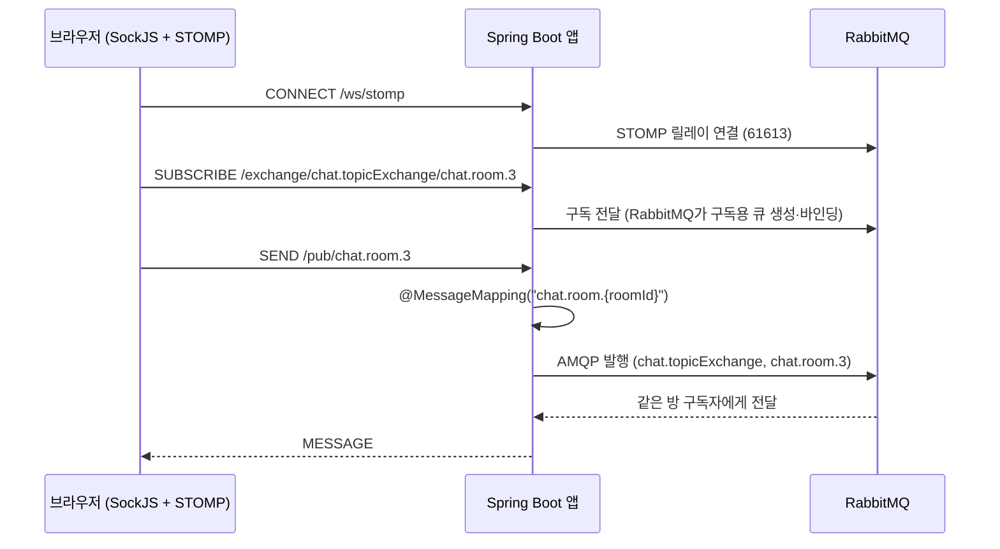

# web-socket

Spring Boot + Kotlin으로 **WebSocket → STOMP → 외부 메시지 브로커(RabbitMQ)** 순서로 실시간 채팅 구조를 단계별로 익혀 보는 학습 프로젝트입니다.

| 모듈 | 내용 |
|---|---|
| [`simple`](./simple) | 순수 WebSocket. `TextWebSocketHandler`로 연결·수신·오류·종료 이벤트를 직접 처리 |
| [`stomp/rabbit-mq`](./stomp/rabbit-mq) | STOMP + RabbitMQ 브로커 릴레이. 채팅방(room)별 메시지와 전체 공지(broadcast) |

## 기술 스택

Kotlin 1.9.25 · Spring Boot 3.4.4 (WebSocket, AMQP) · JDK 17 · Gradle (Kotlin DSL) · RabbitMQ 3.13.7 (STOMP 플러그인) · SockJS

## 아키텍처 (`stomp/rabbit-mq`)

Spring 앱은 메시지를 직접 보관하거나 나눠 주지 않고, **클라이언트와 RabbitMQ 사이를 중계**합니다.
구독은 STOMP 브로커 릴레이를 통해 RabbitMQ가 처리하고, 앱은 `@MessageMapping`으로 받은 메시지를 AMQP로 발행합니다.



### Destination 정리

| 용도 | destination | 처리 |
|---|---|---|
| 연결 | `/ws/stomp` (SockJS) | |
| 방 메시지 전송 | `/pub/chat.room.{roomId}` | `ChatProducer` → `chat.topicExchange`, 라우팅 키 `chat.room.{roomId}` |
| 전체 메시지 전송 | `/pub/chat.public` | `@SendTo("/exchange/chat.fanoutExchange")` |
| 방 메시지 구독 | `/exchange/chat.topicExchange/chat.room.{roomId}` | 같은 roomId 구독자에게만 전달 |
| 전체 메시지 구독 | `/exchange/chat.fanoutExchange` | 접속한 모든 구독자에게 전달 |

## 프로젝트 구조

```
web-socket
├── simple                      # 순수 WebSocket (endpoint: /hello)
│   └── HelloWebSocketHandler, WebSocketConfiguration
└── stomp/rabbit-mq             # STOMP + RabbitMQ
    ├── docker-compose.yml      # RabbitMQ (AMQP 5672 / 관리 UI 15672 / STOMP 61613)
    ├── StompController         # @MessageMapping 수신부
    ├── ChatProducer            # RabbitTemplate 발행부
    └── config
        ├── WebSocketConfig     # STOMP endpoint + 브로커 릴레이 설정
        └── RabbitMQConfig      # Exchange · Queue · Binding 선언
```

## 실행 방법

필요한 것: JDK 17, Docker

**`stomp/rabbit-mq`**

```bash
# 1) RabbitMQ 실행 (STOMP 플러그인 포함)
cd stomp/rabbit-mq
docker compose up -d

# 2) 앱 실행 (http://localhost:8080)
cd ../..
./gradlew :stomp:rabbit-mq:bootRun
```

RabbitMQ 관리 화면은 http://localhost:15672 입니다 (`guest` / `guest`).
브라우저 테스트 화면은 별도 저장소 `web-socket-fe`(SockJS + STOMP.js 정적 페이지 1장)로 만들었습니다. 입장할 방 ID를 `3`처럼 입력하면 방 채팅, `public`을 입력하면 전체 채팅입니다.

**`simple`**

```bash
./gradlew :simple:bootRun
```

브라우저 개발자 도구 콘솔에서 확인할 수 있습니다.

```js
const ws = new WebSocket("ws://localhost:8080/hello");
ws.onopen = () => ws.send("hello");   // 서버 로그에 수신 메시지가 출력됩니다
```

> 루트에서 `./gradlew build`를 실행하면 루트 프로젝트에 메인 클래스가 없어 실패합니다. 모듈을 지정해 주세요. (`./gradlew :simple:bootJar :stomp:rabbit-mq:bootJar`)

## 기술적 설명

### 1. 순수 WebSocket과 STOMP
`simple` 모듈은 `TextWebSocketHandler`로 연결과 텍스트 프레임만 다룹니다. 메시지 포맷, 라우팅, 구독 관리는 모두 직접 만들어야 합니다.
STOMP는 그 위에 `SEND` / `SUBSCRIBE` 같은 프레임과 destination 개념을 얹은 프로토콜이라, "누가 어느 주제를 구독하는가"를 프로토콜 수준에서 표현할 수 있습니다.

### 2. 내장 브로커 대신 브로커 릴레이
`enableStompBrokerRelay`로 외부 RabbitMQ를 브로커로 사용합니다. 내장 `SimpleBroker`는 서버 메모리 안에서만 메시지를 나누기 때문에 서버가 여러 대가 되면 서로 다른 서버에 붙은 사용자끼리 메시지를 주고받을 수 없습니다. 브로커를 밖으로 빼면 앱 서버를 늘려도 같은 브로커를 공유합니다.

### 3. `/pub` 접두사와 `.` 구분자
클라이언트가 보내는 destination은 `/pub`으로 시작해야 `@MessageMapping`으로 연결됩니다(`setApplicationDestinationPrefixes`).
경로 구분자는 `AntPathMatcher(".")`로 `/`에서 `.`으로 바꿨습니다. RabbitMQ의 라우팅 키가 `chat.room.3`처럼 점으로 구분되기 때문에, 앱과 브로커의 표기를 맞추기 위해서입니다.

### 4. Topic Exchange와 Fanout Exchange
- **Topic** (`chat.topicExchange`): 라우팅 키 `chat.room.{roomId}`로 방별 전달
- **Fanout** (`chat.fanoutExchange`): 라우팅 키와 무관하게 구독자 전체에게 전달

### 5. `@SendTo`는 정적 경로에만 쓸 수 있다
전체 채팅은 목적지가 고정이라 `@SendTo`로 충분했습니다. 방 채팅은 destination에 `roomId`가 들어가야 해서 `RabbitTemplate.convertAndSend`로 직접 발행합니다.

## 한계와 다음 단계

- **메시지가 쌓이는 큐**: `chat.queue`, `chat.broadcast`는 영속(durable) 큐인데 소비자(`@RabbitListener`)가 없어서, 전송한 메시지가 그대로 큐에 남습니다. 메시지 이력 저장이나 TTL 설정이 필요합니다.
- **인증·인가 없음**: 모든 Origin 허용, RabbitMQ 기본 계정(`guest`) 사용
- **메시지 형식**: `ChatMessageDTO`에는 `message`만 있어서 클라이언트가 보내는 `sender`, `timestamp`는 전달되지 않습니다.
- **다음 단계**: Redis 또는 Kafka 기반 구조로 확장해 비교해 볼 예정
